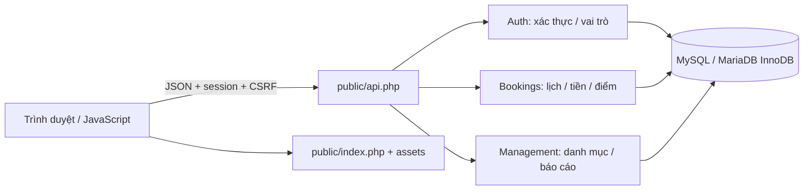
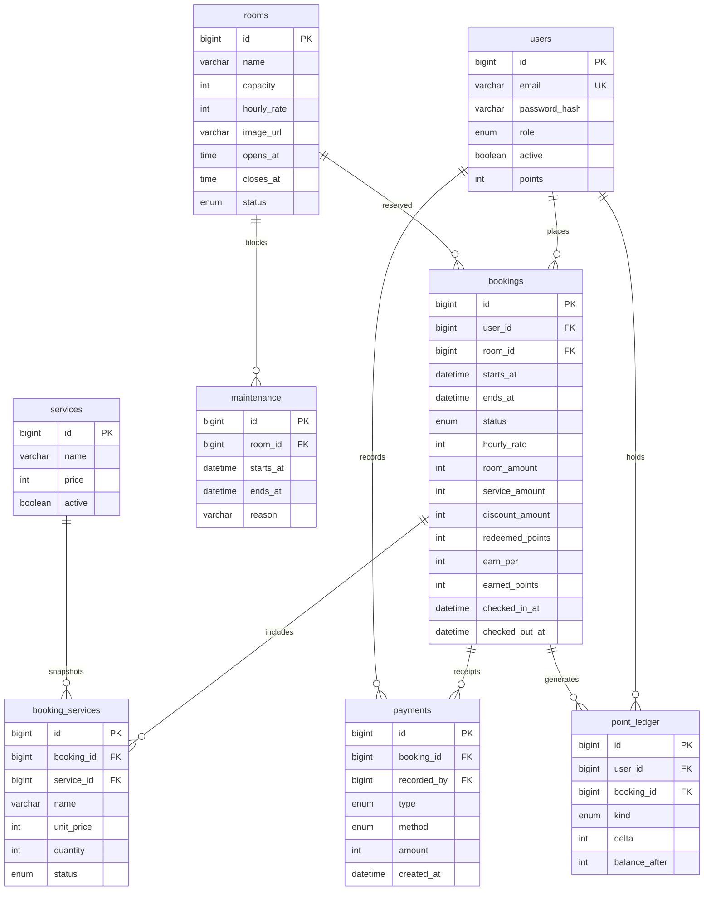
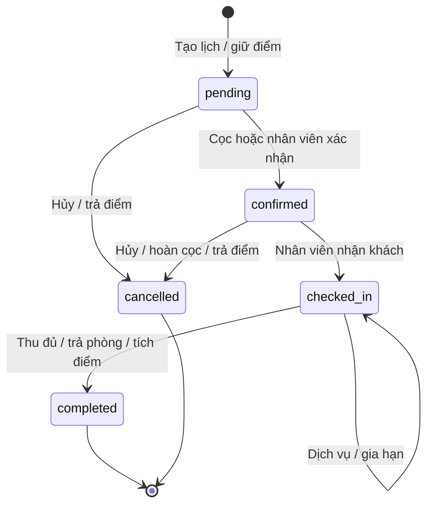

# Thiết kế hệ thống

## Kiến trúc



API nhận JSON object phẳng, trả `{data: ...}` hoặc `{error: ...}`. Lỗi server chi tiết chỉ vào log. PDO dùng prepared statements native. Client không được quyết định giá, điểm cộng hoặc chủ lịch. Document root là public; app/scripts/database không được phục vụ qua HTTP.

## ERD



`settings(id=1, earn_per, point_value)` giữ tỷ lệ hiện tại; `login_attempts(identity_hash, failures, window_start)` giữ bộ đếm login. DDL đầy đủ trong [schema.sql](../database/schema.sql).

| Bảng | Ràng buộc / ý nghĩa |
| --- | --- |
| users | Email unique, role enum, points unsigned; khóa tài khoản thay vì xóa |
| rooms | Giá VND, giờ cùng ngày; ngừng bằng status |
| maintenance | Khoảng chặn phòng, end > start |
| bookings | Snapshot giá/điểm; index `(room_id,starts_at,ends_at,status)`, end > start |
| booking_services | Snapshot tên/giá, quantity > 0, trạng thái ordered/served/cancelled |
| payments | Amount dương, refund được trừ khi tổng hợp, lưu người ghi nhận |
| point_ledger | Delta có dấu, số dư sau giao dịch; unique `(booking_id,kind)` |
| settings | Một bản ghi cấu hình, tỷ lệ > 0 |
| login_attempts | SHA-256(IP+email), không lưu password trong bộ đếm |

InnoDB, utf8mb4, FK, CHECK và UNIQUE. Khoảng thời gian không chống trùng chỉ bằng unique index; mọi thao tác lịch/bảo trì phải khóa phòng. SQL trực tiếp nằm ngoài bảo đảm của API.

## Trạng thái và giao dịch



```mermaid
sequenceDiagram
 actor C as Khách hàng
 participant API as Bookings.create
 participant DB as InnoDB
 C->>API: room, starts_at, ends_at, points
 API->>DB: BEGIN; SELECT room FOR UPDATE
 API->>DB: Kiểm tra booking / maintenance bằng locking read
 alt Trùng hoặc ngoài giờ
  API->>DB: ROLLBACK
  API-->>C: 409 hoặc 422
 else Còn trống
  API->>DB: SELECT user FOR UPDATE
  API->>DB: Tính giá; kiểm tra số dư
  API->>DB: INSERT booking; trừ điểm; INSERT ledger
  API->>DB: COMMIT
  API-->>C: Lịch và tổng dự kiến
 end
```

Hai request cùng phòng chờ cùng một khóa. Request thứ hai đọc lịch bằng `FOR UPDATE` sau khi request trước commit để thấy dữ liệu mới dù isolation repeatable read. Trùng khi `old.starts_at < new.ends_at AND old.ends_at > new.starts_at`.

Checkout khóa phòng → booking → user; kiểm tra trạng thái/dịch vụ; chốt tiền phòng kể cả quá giờ; ghi settlement, cộng điểm và đổi status trong **một transaction**. Lỗi rollback toàn bộ. Replay thấy completed bị từ chối. Mất phản hồi sau commit: tải lại lịch để biết kết quả, không giả định lỗi mạng là chưa thanh toán.

## Giao diện

Sidebar tím đậm, nền sáng, bộ lọc lịch và phòng có hình minh họa. Khách có lịch/điểm/hồ sơ; staff có tổng quan/lịch/khách/báo cáo; admin thêm phòng/dịch vụ/cài đặt. Dialog chi tiết chứa giờ sử dụng, dịch vụ, tiền và thao tác theo trạng thái. Dưới 800px dùng menu đóng/mở; có stylesheet in hóa đơn. Tài nguyên cục bộ, không bắt buộc CDN. URL ảnh chỉ HTTPS hoặc /assets; nội dung người dùng được escape.

## API

`GET /api?action=bootstrap`: user, csrf, rooms, services active, settings, ngày Việt Nam. Client giữ cookie và gửi `X-CSRF-Token` với mọi POST. JSON object phẳng tối đa 16KB. Session hết hạn sau 2 giờ không hoạt động.

| Action | Method | Quyền | Tham số chính |
| --- | --- | --- | --- |
| bootstrap | GET | Công khai | — |
| availability | GET | Công khai | room_id,date |
| register/login/logout | POST | CSRF | name,email,phone,password hoặc email,password |
| profile | POST | Đã login | name,phone,current_password/password tùy chọn |
| book | POST | Đã login | room_id,starts_at,ends_at,points,note |
| bookings/booking | GET | Chủ lịch hoặc staff/admin | status,date,q hoặc id |
| booking_action | POST | Theo quyền/trạng thái | id,operation và trường bổ sung |
| points | GET | Đã login | Ledger của mình |
| customers/customer_history | GET | Staff/admin | q hoặc id khách |
| reports | GET | Staff/admin | from,to dạng YYYY-MM-DD |
| admin_catalog | GET | Admin | — |
| room_save | POST | Admin | id=0 thêm; tên,mô tả,sức chứa,giá,giờ,status,theme,image_url |
| maintenance_save/delete | POST | Admin | room_id,starts_at,ends_at,reason hoặc id |
| service_save | POST | Admin | id=0 thêm; name,price,active |
| account_save | POST | Admin | id,role,active |
| settings_save | POST | Admin | earn_per,point_value |

Operation cho chủ lịch: deposit,cancel. Staff/admin thêm confirm,checkin,checkout,extend (ends_at),service (service_id,quantity),service_status (line_id,status). Method cash/transfer/demo cho staff; khách luôn demo. Không lấy total từ client.

Mã lỗi: 400 sai cấu trúc, 401 chưa login, 403 không quyền, 404 không tồn tại, 405 sai method, 409 xung đột, 413 quá payload, 419 CSRF, 422 validation/nghiệp vụ, 429 login quá nhiều, 500 nội bộ.
